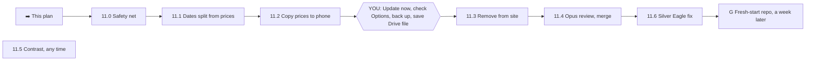

# Nov 17 plan: Red Book prices leave the public site (step 1b(c), Fable, 2026-11-10; nothing built)

Build-ready detail for blueprint part A (`reviews/11`) plus review 13's K1, so each Sonnet session is short. Code facts were checked against v0.58.6. Marks: ✅ checked in the code · 🟥 a guess, check while building · 🟧 I disagree with an earlier doc or see a risk.

## Verdict

- **Doable and safe, but it is two weeks, not one.** Your phone must run the "copy" update for a few days before the "remove" update. 🟧
- **The blueprint missed one thing:** the price files also hold coin facts (which dates exist). Removing them as planned would empty the Washington album pages and all proof spots in the demo and on any new phone. Fix: a small step first (11.1). ✅
- **Worst case is mild.** If everything goes wrong, your coins are untouched and one tap ("Load a price file") brings the values back from the copy in your Google Drive.

## The road (➡️ = where we are)

| Step | What | Size | Model | Merge | Week |
|---|---|---|---|---|---|
| 11.0 | Safety net: old-backup test (blueprint step 0) | S | Sonnet | on green | Nov 17 |
| 11.1 | Dates and varieties split from prices (new) | S | Sonnet | on green | Nov 17 |
| 11.2 | A1: copy prices to the phone | M | Sonnet | **asks you first** | Nov 17 |
| 11.5 | Contrast check (idea 54 + P2 + P3) | S | Sonnet | on green | Nov 17 |
| you | Update now · Options line · backup · Drive file | 5 min | you | | by Nov 23 |
| 11.3 | A2: tests to made-up prices, then remove the files | M | Sonnet | **waits for review** | Nov 24 |
| 11.4 | Review of 11.3, fixes, merge | S | Opus | asks you first | Nov 24 |
| 11.6 | K1: Silver Eagle prices (needs your Red Book page photo) | S | Sonnet | on green | Nov 24 |
| G | Fresh-start repo | S | Sonnet | | about Dec 2 |

11.0 + 11.1 fit one Sonnet chat (two PRs). So: **Nov 17 week = 3 Sonnet chats; Nov 24 week = 2 Sonnet + 1 Opus.**

## 🟧 Push back (planning day decides)

1. **Two weeks.** The Nov 17 budget is 1 L + 1 S. This L has a forced wait in the middle. Nov 24 still has room for one M (I'd pick 52, the walkthrough bug); 77, 55 and 56 slide a week.
2. **Pounds on bars (D1) waits.** The blueprint put it on Nov 17; it would break the budget and nothing depends on it.
3. **K1 moves after the removal, not before A1** (review 13 said before). Fixing it first means typing new Red Book numbers into the public file, which is the thing we are stopping. Instead the fix arrives as a private price file you load on the phone. The wrong $480 stays about one more week; loading a file replaces the whole price list, so no wrong rows are left behind.
4. **Fresh-start repo (G) lands in early December**, not late November: it needs a week after 11.4.
5. **Other phones with the app (for example Jinny's):** a phone that is not opened between 11.2 and 11.4 loses its Red Book values (coins stay). Open the app once on each during the wait, or accept that.

## What I checked in the code ✅

- 13 series, 1,363 price rows, 67 KB, in `catalog/pricebook.js` and `catalog/pricebook-modern.js`. Loaded by `index.html` (lines 44-45), cached by `sw.js` FILES, copied into every view-only file by `snapshot.js` SNAP_FILES. **Every snapshot shared so far carries the whole price list.**
- `PRICE_BOOK` is a `const`. Used in `values.js` (35, 39, 78, 108, 139, 287), `albums.js` (12, 13, 299), `coinform.js` (159), `options.js` (86-87), `report.js` (93).
- **Coin facts taken from price rows today:** Washington quarter album spots (`pricebook.js` 13-25 fills `EXACT_SLOTS`) · proof spots and proof mints (`albums.js` 12-13) · variety choices (`albums.js` 303, `values.js` 59) · the FB/FBL and SMS ticks (`coinform.js` 159, `values.js` 35 and 287).
- Backup copies every record (`buildBackup`), so a new `pricebook` record rides along. Restore replaces any record that isn't a coin, settings or history (`mergeRestored`), so **an old backup could overwrite newer prices**. Needs one rule (11.2).
- 15 test files check Red Book values; all pages pass through one shared setup, `tests/_compat.js`.
- `?demo` and private windows never touch saved records; the Claude test copy (`db` mode) replaces all records on every sync.

## 11.0 Safety net (S, Sonnet)
As blueprint step 0, unchanged: `tests/fixtures/backup-v058.json` + `tests/oldbackup.js`. Add one case: a backup holding a record kind the app doesn't know restores without error and is still there after a second backup.
- **Your check:** none (test only).

## 11.1 Dates split from prices (S, Sonnet) — new step
- **What:** new public file `catalog/bookfacts.js`: for each of the 13 series, only the row names (date, mint, variety) per table. No prices, no mintages. About 15 KB. Made by a throwaway script from today's files, not typed.
- Switch the facts uses listed above to read it. Move the Washington `EXACT_SLOTS` filler out of `pricebook.js`. Add the file to `index.html`, `sw.js` FILES, `snapshot.js` SNAP_FILES.
- **Test `nobook.js`:** empty the price list in the page, then: Washington album spot count, proof spots, 1878 Morgan variety choices and the Mercury FB tick are the same as before; no errors.
- **No change to saved data. Nothing you can see changes.**
- **Costly to change later?** No. Dates and variety names are coin facts the app already keeps for 34 types.

## 11.2 A1: copy prices to the phone (M, Sonnet; asks you before merging)
**Saved:** one new record, key `pricebook`: `{ kind: "pricebook", format: 1, edition, series, mintage, savedAt }`.

Builder notes:
- Shipped files rename their object to `SHIPPED_PRICE_BOOK`. `app.js` gets `let PRICE_BOOK` (empty shape) and `loadPriceBook()`, called at the end of every start path and inside the `db` sync callback.
- **Rule: copy only when the phone has no record.** Never overwrite one (so a file you load later always wins). Simpler than comparing editions.
- By mode: `local` and `db` read the record · private window uses the shipped copy, saves nothing · `?demo` gets no Red Book values (your decision 3) · snapshot: see next line.
- **View-only file:** leave `pricebook` out of `snapshotDocs`; stamp each coin with its worked-out value text and mintage; in snapshot mode the lookups return the stamp. Take both price files out of SNAP_FILES now.
- **Restore rule:** in `mergeRestored`, for `pricebook` keep the one with the later `savedAt`; if the backup has none, keep the phone's.
- Check that nothing listing coins or albums trips over the new record (lists already go by key or `kind`). 🟥
- **Options › Red Book values:** "Red Book prices on this phone: 2026 · 13 series · saved Nov 18", or "No Red Book prices on this phone."
- **Private copy:** Claude builds `coin-cabinet-prices-2026.json` (`{ kind: "coin-cabinet-prices", format: 1, edition, series, mintage }`) and sends it in the chat. Never committed.
- 🟥 The Claude test copy may refuse a 67 KB record. If so it just shows no Red Book values there; don't spend time on it.

**Tests:** fresh start saves a record equal to the shipped one · block both shipped files and reload: a known coin shows the same value · a record that differs from the shipped one wins · demo shows none · the snapshot file holds no price table and a coin in it shows the same value · restore keeps the newer one · 11.0 test still green.

**Your checks:** Options shows the line · three coins you know show the same values as before · Home total unchanged.

**Costly to change later?** Yes, a little: the record name and the two `format: 1` numbers travel in your backups and Drive file. They are in from day one, so a later change can convert old ones.

## You, between 11.2 and 11.3 (about 5 minutes)
1. Tap **Update now**. Open Options, see the "Red Book prices on this phone" line.
2. Options › **Back up** and keep the file.
3. Save the price file from the chat to Google Drive.
4. Open the app once on any other phone that has it.
5. Send your Red Book **Silver Eagle page** photo any time (for 11.6).

## 11.3 A2: remove from the site (M, Sonnet; label `waits for review`)
Two commits in one PR:
1. **Tests to made-up prices.** `tests/fixtures/prices.json`: invented numbers, only the rows the tests use (cap 60 rows). Load it through `tests/_compat.js` so the 15 files change only their expected numbers. Prefer no test-only code in the app. The "every date has a price" checks in `redbookmodern.js` can't stay public; drop them (the loader's count below replaces them).
2. **Remove.** Delete both price files; take them out of `index.html` and `sw.js` FILES. Options › Red Book values gets **Load a price file** and **Save price file**.
   - Load checks: right `kind`, `format` 1, every table has a grade list and rows of that length holding numbers or blanks, under 2 MB. A bad file is refused and the old prices stay. A good one asks first: "13 series, 1,363 rows; 4 dates in the app's lists have no row. Replace the prices on this phone?" Undo on the toast.
   - No record: coins show no Red Book value (typed values and melt work); Options says how to load a file.
   - **Guard test `noprices.js`:** fails if `catalog/pricebook*.js` exists, or any file outside `tests/fixtures/prices.json` holds a price table, or the fixture passes 60 rows.
   - Update `README.md` (lines 5, 24) and `NOTICE.md` wording. Add a What's new line.
- **Start gate:** the session first asks you to confirm steps 1-3 above. No confirmation, no build.

## 11.4 Review (S, Opus)
One reviewer, pointed at 11.3's files, reproduced problems only:
- a phone that jumps from v0.58 straight to this version (never ran 11.2): no crash, coins intact, clear way to load a file
- restore the 11.0 old backup onto a phone with prices (prices stay); restore a new backup onto an empty phone (values match)
- bad price files: cut short, wrong shape, text where numbers go, odd names
- value-over-time chart: no false dip when prices are missing 🟥
- seller pricing, insurance report and spreadsheet export with no prices
- the snapshot file and the guard test can't be fooled; app opens offline right after the update
Then fixes, your OK, remove the label, merge.

**Your checks after merge:** Update now · same three coins, same values · Options line still there · save a view-only file and open it: values show.

## 11.5 Contrast (S, Sonnet; any time, no order)
- `tests/contrast.js`: walk every page and pop-up in the demo, measure each button and text against its background, fail under 4.5 to 1 (3 to 1 for large text). Fix what it lists, starting with the white Refresh button on the Insurance report (idea 54). The test stays, so it can't come back.
- P2: no text under 12 px on Home. P3: Home stack chip and Refresh get 40 px of tap room.
- **Your checks:** Refresh on the Insurance report is readable · album names on the shelf are readable.

## 11.6 K1: Silver Eagle prices (S, Sonnet; after 11.4, needs your photo)
- ✅ Today the ordinary coins of 2000-2014 and 2018-2019 are filed under "W", and the plain 2015 row is the rare one (mintage 79,640). 🟥 How the book labels the rows comes from your photo; nothing is guessed.
- You attach your price file from Drive and the page photo. Claude returns a corrected file: the common coin under the plain date, "(P)", "(S)", "(W)" as choices. You load it; the old one stays in Drive as the undo.
- One small code change (public, no prices): a Silver Eagle already saved with "W" still finds its value, and `bookfacts.js` gets the new choice names.
- **This is how all future Red Book pages arrive:** attach the file, get it back, load it.
- **Your checks:** a plain 2015 Eagle in MS-69 shows a normal value · a 2005 with no mint mark shows a value.

## Risks at a glance

| Risk | Chance | Hurt | Guard |
|---|---|---|---|
| Remove lands before your phone copied | Low | Values gone until you load the Drive file | Two updates · start gate · Options line · Drive file |
| Album spots vanish with the prices | Certain without 11.1 | Washington and proof pages empty | 11.1 + `nobook.js` |
| Old backup overwrites newer prices | Medium | Wrong values, quietly | "Later one wins" rule + test |
| Prices leak back into public files | Medium over time | Undoes the work | Guard test on every PR |
| Another phone misses the window | Medium | That phone shows melt only | Open it once, or accept |

## Start prompts
Each one starts: *"Open my repo waddelljmw/CoinShelfTest. Read CLAUDE.md and reviews/14-nov17-plan.md."* then:
- **Sonnet:** "Build 11.0, merge when green, then 11.1, merge when green."
- **Sonnet:** "Build 11.2. Ask me before merging. Send me the private price file."
- **Sonnet:** "Build 11.5, merge when green."
- **Sonnet:** "I did the phone steps. Build 11.3 with the waits for review label. Don't merge."
- **Opus:** "Do 11.4: review the 11.3 PR, fix, ask me, merge."
- **Sonnet:** "Do 11.6. My price file and Red Book page are attached."

## Questions for planning day (one message)
1. Two-week spread OK, with 52 as the Nov 24 extra?
2. K1 after the removal, by private file?
3. Should any other phone keep its Red Book values?
4. Pounds on bars waits?
